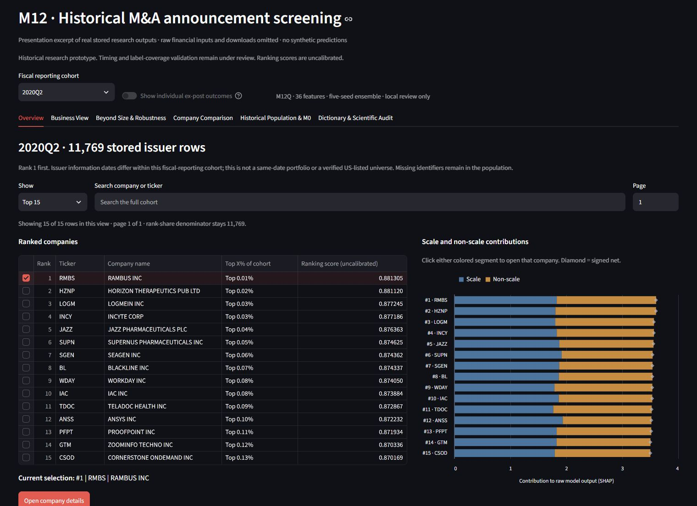
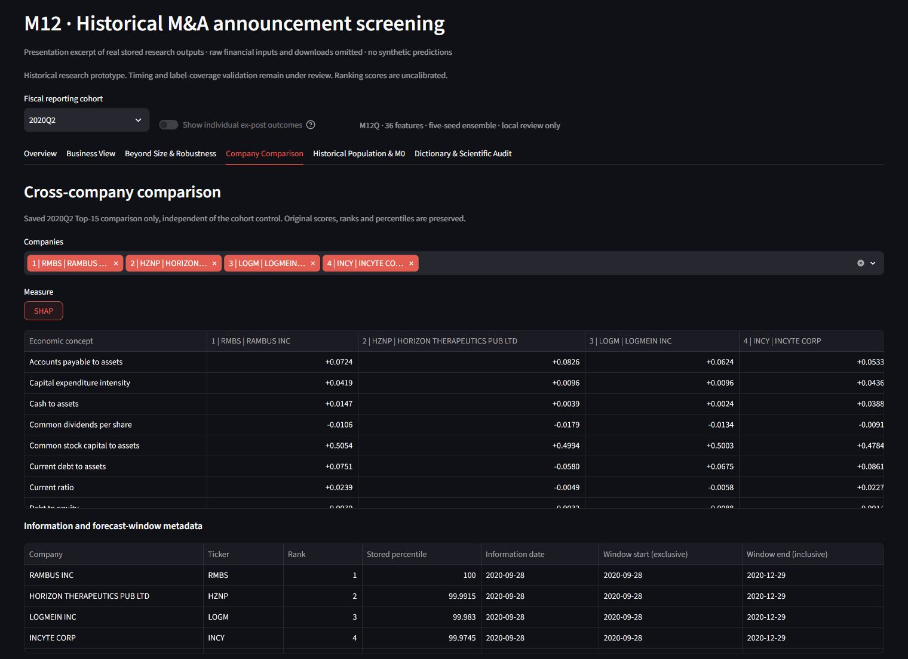

# M&A announcement screening and explainability

This historical research MVP turns saved company-level model outputs into an **Overview-first screening workflow**: inspect ranked issuers, open a company, see what contributes to its score, compare names, and review the supporting historical diagnostics. Its intended use is U.S. public-company M&A research. The saved SEC-filer cohorts have **not** been validated as a U.S.-listed-only universe.

The model ranks potential **M&A-announcement SEC-filer/participant appearance in a following historical 92-day window**. It does not identify which company will be an acquisition target or acquirer. The explainability layer separates signed **Scale vs Non-scale** contributions and drills down to company-level drivers.

**Scores are uncalibrated. Historical timing and label-coverage validation remain under review.** This is a historical research prototype, not a production trading or deal-execution system, a current-market prediction service, or a scientific approval. Earlier saved PASS/GS-ready statuses describe historical engineering checks, not current scientific certification.

## What the reviewer can inspect

| Question | Saved output and dashboard view |
|---|---|
| Which issuers rank highest? | Overview lists names, original full-cohort ranks, inclusive Top X% and uncalibrated scores. A signed contribution chart opens the selected issuer's Business View. |
| Why does a company rank there? | Business View shows its information date and forecast window, signed Scale/Non-scale totals, and ranked drivers. Positive and negative SHAP contributions raise or lower the model's raw output relative to its saved baseline. |
| Is the result just a size effect? | Beyond Size & Robustness presents scale-only, non-size and missingness comparators, plus saved seed-stability diagnostics. |
| How do the leading names differ? | Company Comparison aligns saved ranks and model explanations across selected companies. Raw financial values are hidden in the published captures. |
| What supports the research interpretation? | Historical Population & M0 provides descriptive context; Dictionary & Scientific Audit exposes feature definitions, the target contract and engineering-check caveats. |

The selected saved model is `M12Q_quarterly_only_full_population_median`: a five-seed ensemble with 36 quarterly-only features. This application reads saved results; it performs no training, calibration, inference or new SHAP computation. With authorized local dependencies, `app.py` opens the reviewed UI. Without them, it displays a clear code-only notice rather than invented results.

## Dashboard screenshots

Selected views from the historical research dashboard illustrate issuer screening, real saved ranking outputs, signed Scale / Non-scale contributions, company-level drivers, robustness diagnostics, and the engineering/audit layer. Ranking scores are uncalibrated; these views are a historical research prototype, not a production-ready system.

**Presentation-safe captures of existing outputs.** Company names, ranks, percentiles, scores, timing fields and signed SHAP explanations remain visible. Raw vendor financial/model-input values and downloadable issuer-level tables are omitted. No company predictions or SHAP results were invented. Click an image for the full-resolution view.

<table>
<tr>
<td width="50%"><a href="assets/screenshots/01_overview.png"></a><br>Overview — ranked issuer screening workflow and signed Scale / Non-scale contributions</td>
<td width="50%"><a href="assets/screenshots/02_business_view.png"></a><br>Business View — company-level rank, uncalibrated score, forecast window, and top drivers</td>
</tr>
<tr>
<td width="50%"><a href="assets/screenshots/03_beyond_size_robustness.png"></a><br>Beyond Size &amp; Robustness — robustness evidence versus size-only and related diagnostics</td>
<td width="50%"><a href="assets/screenshots/04_company_comparison.png"></a><br>Company Comparison — cross-company comparison of ranked names and model outputs</td>
</tr>
<tr>
<td width="50%"><a href="assets/screenshots/05_historical_population.png"></a><br>Historical Population &amp; M0 — descriptive historical evidence behind the screening framework</td>
<td width="50%"><a href="assets/screenshots/06_dictionary_scientific_audit.png"></a><br>Dictionary &amp; Scientific Audit — feature definitions, target contract, and audit trail</td>
</tr>
</table>

All six captures use the reviewed Overview-first UI, dark theme and individual ex-post outcomes OFF. The screenshot-only display adapter hides restricted values without changing stored results or the application. See [DATA_NOTICE.md](DATA_NOTICE.md) and [CHECKPOINT_QA.md](CHECKPOINT_QA.md) for the disclosure boundary and verification evidence. The older `assets/dashboard_preview.png` remains unchanged for historical continuity; it is not the current reviewed gallery.

Financial data source: **Compustat North America via WRDS**. Event data comes from the project's licensed/authorized historical sources. Model rankings and SHAP analyses shown here are author-generated research outputs. Attribution does not grant permission to redistribute source data or the complete issuer-level output files.

## Historical evidence at a glance

The table below reproduces existing **M12Q five-seed ensemble** diagnostics for all three saved fiscal-reporting cohorts. A cohort label is not a common prediction date: each issuer has its own information date and subsequent 92-day label window. Counts are evaluated rows and stored positives, not a newly certified U.S.-listed population.

| Fiscal cohort | Evaluated rows / stored positives | Average precision, M12Q / scale-only | ROC-AUC, M12Q / scale-only | Top-50 positives, M12Q / scale-only | Top-15 positives, M12Q |
|---|---:|---:|---:|---:|---:|
| 2018Q4 | 11,278 / 107 | 0.0421 / 0.0341 | 0.8624 / 0.8263 | 3 / 3 | 1 |
| 2019Q2 | 11,621 / 115 | 0.0565 / 0.0434 | 0.8568 / 0.8246 | 5 / 2 | 1 |
| 2020Q2 | 11,769 / 102 | 0.0365 / 0.0251 | 0.8267 / 0.7913 | 5 / 1 | 0 |

Source: [saved ensemble metrics](data/public/historical_M12_ensemble_metrics.csv), `candidate=M12Q_quarterly_only_full_population_median`, `diagnostic_kind=candidate` and `scale_only`; AUC values rounded to four decimals. Average precision is the saved PR-summary metric. These are descriptive retrospective results, not recomputed or independently revalidated performance estimates.

The saved candidate has higher average precision and ROC-AUC than scale-only in all three cohorts. That does **not** imply uniformly strong top-ranked outcomes: the 2020Q2 candidate has zero stored positives in its Top 15, and its 2018Q4 Top-50 count only ties scale-only. Low event prevalence, unresolved timing/data-vintage evidence, label maturity and negative-label coverage limit the conclusions. The dashboard also exposes [non-size, frequency and missingness comparisons](data/public/historical_M12_ensemble_metrics.csv), [seed stability](data/public/historical_M12_rank_stability_summary.csv) and [paired bootstrap diagnostics](data/public/historical_M12_paired_bootstrap_comparisons.csv); none supersede those validation caveats.

## Reviewed interactions

- Overview defaults to the stored Top 15; Top 25/50/100, full-list pagination, and company/ticker/GVKEY search are available.
- Click either signed Scale or Non-scale bar segment to open that exact issuer in Business View. Table selection also has an explicit company-details button.
- Original full-cohort rank, score, identity, information date, and forecast window remain unchanged. Search and pagination never re-rank the population.
- Business View combines rank and inclusive Top X% in one card, retains detailed drivers/remainders, and reconciles saved signed SHAP against the saved ensemble baseline and score.
- Six destinations retain robustness, comparison, historical population/M0, dictionary, and scientific-audit material. Individual ex-post outcomes are off by default.

The score is a logistic transform of the saved raw model output, not a calibrated event probability. Signed SHAP totals reconcile to raw output relative to the saved baseline; their units are not percentage-point changes in event probability. Scale attribution is a model explanation, not a causal effect of company size.

Inclusive Top X% is the original rank divided by all stored cohort rows; it is not the stored score percentile. Neither search nor a screenshot subset changes the original rank or denominator.

## Local launch

Python 3.12 is the tested runtime. Pinned dependencies match locally tested versions; no source research environment was upgraded.

```powershell
python -m venv .venv
.\.venv\Scripts\python.exe -m pip install -r requirements.txt
.\.venv\Scripts\python.exe -B -m streamlit run app.py --server.address=127.0.0.1 --server.port=8502 --browser.gatherUsageStats=false --server.headless=true
```

Open `http://127.0.0.1:8502`. With no private files this renders a missing-data notice, not invented companies, scores, or explanations. The previously approved static preview remains unchanged at `assets/dashboard_preview.png`; it depicts the older Business View, not this revised Overview.

## Authorized local data, never Git data

See [DATA_NOTICE.md](DATA_NOTICE.md) for exact local-only dependencies. Default location: `data/private/` (ignored). For authorized read-only use without copying research outputs:

```powershell
$env:M12_PRIVATE_DATA_DIR = 'D:\authorized-local-data\m12'
$env:M12_M0_FORENSIC_PATH = 'D:\authorized-local-data\m11\historical_M11_M0_SPX_75_feature_forensic.csv'
```

The second variable is optional when the M0 forensic CSV is already in the private directory. These are explicit local paths, not auto-discovery, downloads, or source-repository backreferences. Public summaries and the feature dictionary always come from this repository's `data/public/`. The full preregistration and baseline/model manifest remain local-only. Runtime validates exact ordered features, five seeds, identity, and signed reconciliation; model binaries are neither required nor loaded.

## Tests

```powershell
.\.venv\Scripts\python.exe -m pip install -r requirements-dev.txt
.\.venv\Scripts\python.exe -B -m pytest tests -q -rs -p no:cacheprovider
```

Without private artifacts, data-dependent tests explicitly skip; a skip is not a pass. With authorized paths configured, the copied review suite checks all saved selected-cohort rows, signed SHAP reconciliation, and UI state through the documented entry point. Optional `M12_PRESERVATION_MANIFEST` points to a separately retained local preservation manifest; its test skips when absent. See [CHECKPOINT_QA.md](CHECKPOINT_QA.md) for actual test scope and browser results.

## Scientific scope and limitations

The stored target is SEC-filer/participant appearance in the locally linked announcement corpus during `(information_available_date, information_available_date + 92 calendar days]`. It is not a buyer, seller, acquirer, or target-role prediction. A saved zero is a fixed-corpus nonmatch, not verified event absence.

- Fiscal-reporting cohorts are not same-date portfolios or a certified US-listed universe.
- Timing, historical data-vintage, label maturity, and negative-label coverage remain unresolved; unqualified leakage-safe and GS-ready claims were withdrawn by the subsequent evidence-closure review.
- Stored metrics are qualified retrospective diagnostics; ranking scores are not calibrated event probabilities.
- Exact SHAP addition does not establish causality, temporal validity, cross-regime stability, or redistribution rights.
- This checkpoint does not authorize current-quarter model refresh, production use, deployment, investment decisions, or external data sharing.

## Research lineage and attribution

This packages existing collaborative research, not a claim of sole authorship of the underlying modeling. Daniel's legacy notebook/portfolio-selection work remains a separate lineage from the selected M12Q model; its historical Top-10 claims must not be attributed to the M12Q results above. Ryu's technical questions remain interview-preparation context and are not added to the dashboard or used to change models. Existing source artifacts and the original dashboard are preserved outside this sharing copy. This is an independent research presentation, not a Goldman Sachs system or a claim of equivalent internal performance.

## Files

`app.py` routes to `dashboard/historical_m12_review_ui.py`; `dashboard/m12_review_ui_helpers.py` retains the reviewed numerical and identity logic. `dashboard/sharing_paths.py` isolates public/private routing. Tests live in `tests/`. [MANIFEST.csv](MANIFEST.csv) inventories tracked files and separately records excluded local dependencies. Existing aggregate evidence and the approved preview are unchanged. No new license or redistribution permission is granted.

Included-file sizes and SHA-256 hashes use Git's LF-normalized text bytes (binary bytes unchanged), so Windows checkout line endings do not change their meaning. Excluded dependencies and `source_sha256` use exact original file bytes. The manifest excludes its own recursive hash. The six gallery PNGs are presentation-safe captures, not byte-identical copies of private source outputs; their original-source hash field is therefore blank.
