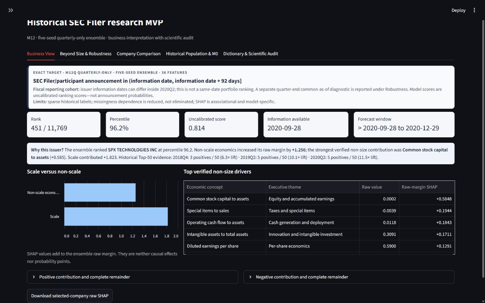

# Historical SEC Filer research MVP

This Streamlit dashboard ranks U.S. public companies for appearance as an SEC filer or participant in an M&A announcement over the following 92 calendar days. It is a sanitized historical-research snapshot prepared for private GS feedback.



## What the dashboard explains

The Business View brings together a company’s historical rank, percentile, information-available date, forecast window, Scale versus Non-scale SHAP contribution, and verified economic drivers. The remaining views document multi-seed robustness, missingness sensitivity, cross-company comparisons, historical population findings, the selected feature dictionary, and scientific QA.

The selected research model is `M12Q_quarterly_only_full_population_median`, a five-seed ensemble with 36 quarterly-only features. Evaluation snapshots are 2018Q4, 2019Q2, and 2020Q2.

Company scale remains important, but the model also retains meaningful non-size signal. “Scale” aggregates the immutable scale-feature subset; “Non-scale” contains the remaining verified economic features. SHAP values add to the ensemble raw margin.

## Data availability

This Git repository is intentionally **code-only**. It includes the dashboard source, small aggregate research results, display contracts, QA summaries, and one approved static preview. Issuer-level derived vendor data is excluded because the local documentation does not establish redistribution rights, even to a private GitHub repository.

The application starts safely without those files and displays the data notice. To enable the interactive Business View, an authorized reviewer must place the exact local-only files listed in [DATA_NOTICE.md](DATA_NOTICE.md) under `data/private/`.

No raw Compustat, WRDS, CRSP, DMA, FactSet, Pandects, training, full-prediction, or full-SHAP extract is included.

## Launch

Python 3.12 is the verified runtime.

```powershell
python -m venv .venv
.\.venv\Scripts\python.exe -m pip install -r requirements.txt
.\.venv\Scripts\python.exe -m streamlit run app.py
```

Without the authorized local-only files, this command renders the sanitized code-only notice and preview. With all listed files present, it renders the current M12 interactive dashboard.

## Repository structure

```text
app.py                         Streamlit entry point
assets/dashboard_preview.png  Sanitized static preview
data/public/                   Small aggregate evidence and display contracts
data/private/                  Local-only runtime files; ignored by Git
.streamlit/config.toml         Reproducible visual/server configuration
DATA_NOTICE.md                 Data classification and local-only file contract
MANIFEST.csv                   Dependency and tracked-file inventory
requirements.txt               Pinned direct runtime dependencies
```

## Exact target definition

For the deterministically selected issuer feature row, the label is 1 if and only if the earliest locally linked DMA/FactSet M&A announcement for that row’s valid SEC CIK is strictly after `information_available_date` and no later than 92 calendar days after that date. Otherwise the label is 0.

The model predicts SEC filer or participant appearance. It does **not** predict buyer, seller, acquirer, or target roles.

## Scientific limitations

- Fiscal-reporting cohorts are not same-date portfolios.
- The score is uncalibrated and is not a literal deal probability.
- SHAP is associative and model-specific, not causal.
- Missingness dependence is reduced, not eliminated.
- Historical labels are sparse.
- Cross-regime stability and correlated model-effect grouping have not yet been established.
- This repository does not claim production readiness or applicability to current 2025 or 2026 companies.
- Independent review of the M12 research package is still in progress.

This is a historical research MVP, not a production trading, investment, or transaction recommendation system.
