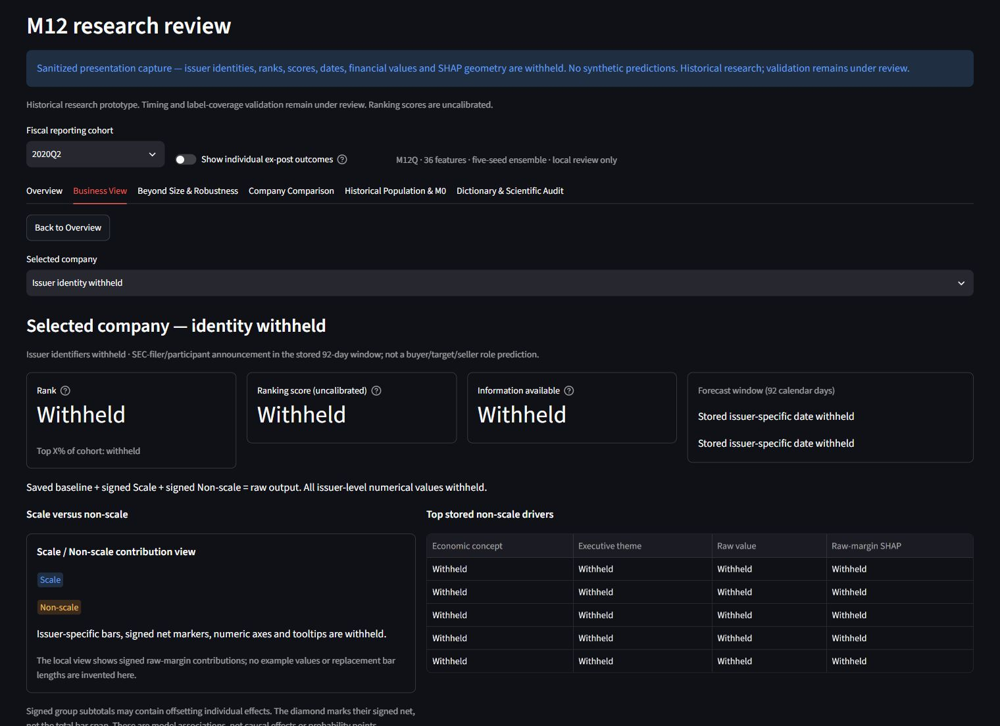
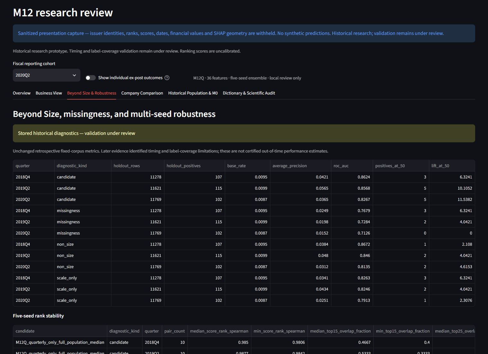
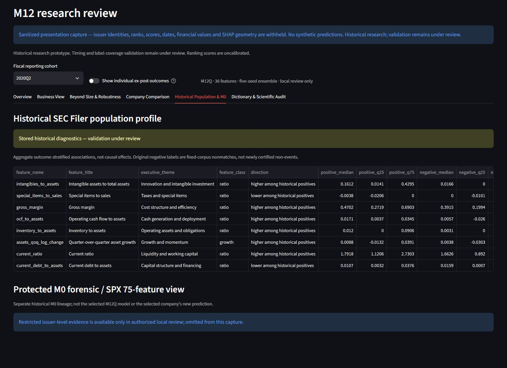
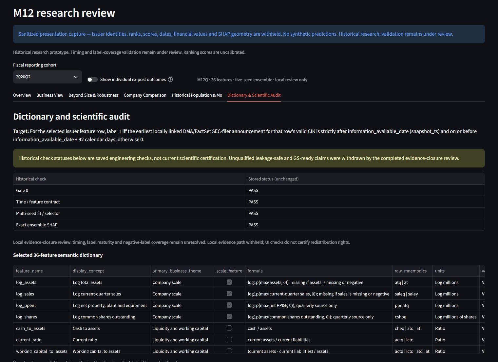

# Historical SEC Filer research review

This private repository is a code checkpoint of a collaborative historical M&A research dashboard. The documented `app.py` entry point opens the reviewed **Overview-first** UI when authorized local dependencies are available, and a graceful code-only notice otherwise.

**Historical research prototype. Timing and label-coverage validation remain under review. Ranking scores are uncalibrated.** This checkpoint is not a full-data backup, scientific approval, or authorization to redistribute licensed data. Earlier saved PASS/GS-ready statuses describe historical engineering checks, not current scientific certification.

## Dashboard screenshots

Selected views from the current reviewed historical research dashboard are shown below. The screenshots illustrate the screening and explainability workflow; stored ranking scores are uncalibrated and historical timing / label-coverage validation remains under review.

**Sanitized presentation captures, not newly shareable issuer-level results.** Identities, issuer-specific ranks/scores/dates, financial values, ranked drivers, fitted baselines and SHAP bar geometry are withheld where present. No synthetic company predictions or replacement numerical results were invented. Existing approved aggregate diagnostics and dictionary definitions remain visible. Click an image to inspect its full-resolution view.

<table>
<tr>
<td width="50%"><a href="assets/screenshots/01_overview.png"></a><br>Overview — ranked issuer screening and signed Scale / Non-scale contributions</td>
<td width="50%"><a href="assets/screenshots/02_business_view.png"></a><br>Business View — company-level ranking, forecast window and financial drivers</td>
</tr>
<tr>
<td width="50%"><a href="assets/screenshots/03_beyond_size_robustness.png"></a><br>Beyond Size &amp; Robustness — scale, missingness and stability diagnostics</td>
<td width="50%"><a href="assets/screenshots/04_company_comparison.png"></a><br>Company Comparison — cross-company financial and SHAP comparison</td>
</tr>
<tr>
<td width="50%"><a href="assets/screenshots/05_historical_population.png"></a><br>Historical Population &amp; M0 — descriptive historical population evidence</td>
<td width="50%"><a href="assets/screenshots/06_dictionary_scientific_audit.png"></a><br>Dictionary &amp; Scientific Audit — feature definitions, target contract and engineering audit trail</td>
</tr>
</table>

All six captures use the reviewed Overview-first UI, dark theme and individual ex-post outcomes OFF. Sensitive views demonstrate the interface rather than disclose the hidden results. See [DATA_NOTICE.md](DATA_NOTICE.md) and the screenshot section of [CHECKPOINT_QA.md](CHECKPOINT_QA.md) for the exact disclosure boundary. The older `assets/dashboard_preview.png` remains unchanged for historical continuity; it is not the current reviewed gallery.

## Reviewed interactions

- Overview defaults to the stored Top 15; Top 25/50/100, full-list pagination, and company/ticker/GVKEY search are available.
- Click either signed Scale or Non-scale bar segment to open that exact issuer in Business View. Table selection also has an explicit company-details button.
- Original full-cohort rank, score, identity, information date, and forecast window remain unchanged. Search and pagination never re-rank the population.
- Business View combines rank and inclusive Top X% in one card, retains detailed drivers/remainders, and reconciles saved signed SHAP against the saved ensemble baseline and score.
- Six destinations retain robustness, comparison, historical population/M0, dictionary, and scientific-audit material. Individual ex-post outcomes are off by default.

The saved selected model is `M12Q_quarterly_only_full_population_median`, a five-seed ensemble with 36 quarterly-only features and fiscal-reporting cohorts 2018Q4, 2019Q2, and 2020Q2. No training, calibration, inference, or new SHAP computation is part of this application.

## Local launch

Python 3.12 is the tested runtime. Pinned dependencies match locally tested versions; no source research environment was upgraded.

```powershell
python -m venv .venv
.\.venv\Scripts\python.exe -m pip install -r requirements.txt
.\.venv\Scripts\python.exe -B -m streamlit run app.py --server.address=127.0.0.1 --server.port=8502 --browser.gatherUsageStats=false --server.headless=true
```

Open `http://127.0.0.1:8502`. With no private files this renders a missing-data notice, not invented companies, scores, or explanations. The previously approved static preview remains unchanged at `assets/dashboard_preview.png`; it depicts the older Business View, not this revised Overview.

## Authorized local data, never Git data

See [DATA_NOTICE.md](DATA_NOTICE.md) for exact local-only dependencies. Default location: `data/private/` (ignored). For authorized read-only use without copying research outputs:

```powershell
$env:M12_PRIVATE_DATA_DIR = 'D:\authorized-local-data\m12'
$env:M12_M0_FORENSIC_PATH = 'D:\authorized-local-data\m11\historical_M11_M0_SPX_75_feature_forensic.csv'
```

The second variable is optional when the M0 forensic CSV is already in the private directory. These are explicit local paths, not auto-discovery, downloads, or source-repository backreferences. Public summaries and the feature dictionary always come from this repository's `data/public/`. The full preregistration and baseline/model manifest remain local-only. Runtime validates exact ordered features, five seeds, identity, and signed reconciliation; model binaries are neither required nor loaded.

## Tests

```powershell
.\.venv\Scripts\python.exe -m pip install -r requirements-dev.txt
.\.venv\Scripts\python.exe -B -m pytest tests -q -rs -p no:cacheprovider
```

Without private artifacts, data-dependent tests explicitly skip; a skip is not a pass. With authorized paths configured, the copied review suite checks all saved selected-cohort rows, signed SHAP reconciliation, and UI state through the documented entry point. Optional `M12_PRESERVATION_MANIFEST` points to a separately retained local preservation manifest; its test skips when absent. See [CHECKPOINT_QA.md](CHECKPOINT_QA.md) for actual test scope and browser results.

## Scientific scope and limitations

The stored target is SEC-filer/participant appearance in the locally linked announcement corpus during `(information_available_date, information_available_date + 92 calendar days]`. It is not a buyer, seller, acquirer, or target-role prediction. A saved zero is a fixed-corpus nonmatch, not verified event absence.

- Fiscal-reporting cohorts are not same-date portfolios or a certified US-listed universe.
- Timing, historical data-vintage, label maturity, and negative-label coverage remain unresolved; unqualified leakage-safe and GS-ready claims were withdrawn by the subsequent evidence-closure review.
- Stored metrics are qualified retrospective diagnostics; ranking scores are not calibrated event probabilities.
- Exact SHAP addition does not establish causality, temporal validity, cross-regime stability, or redistribution rights.
- This checkpoint does not authorize current-quarter model refresh, production use, deployment, investment decisions, or external data sharing.

## Research lineage and attribution

This packages existing collaborative research, not a claim of sole authorship of the underlying modeling. Daniel's legacy notebook/portfolio-selection work remains a separate lineage from the selected M12Q model. Ryu's technical questions remain interview-preparation context and are not added to the dashboard or used to change models. Existing source artifacts and the original dashboard are preserved outside this sharing copy.

## Files

`app.py` routes to `dashboard/historical_m12_review_ui.py`; `dashboard/m12_review_ui_helpers.py` retains the reviewed numerical and identity logic. `dashboard/sharing_paths.py` isolates public/private routing. Tests live in `tests/`. [MANIFEST.csv](MANIFEST.csv) inventories tracked files and separately records excluded local dependencies. Existing aggregate evidence and the approved preview are unchanged. No new license or redistribution permission is granted.

Included-file sizes and SHA-256 hashes use Git's LF-normalized text bytes (binary bytes unchanged), so Windows checkout line endings do not change their meaning. Excluded dependencies and `source_sha256` use exact original file bytes. The manifest excludes its own recursive hash. The six new gallery PNGs are explicitly sanitized captures, not byte-identical copies of private source outputs; their original-source hash field is therefore blank.
